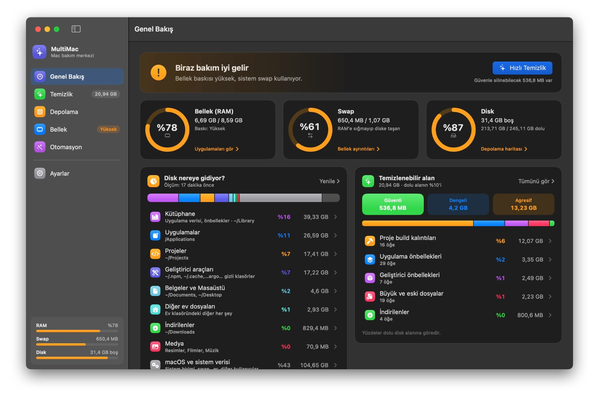
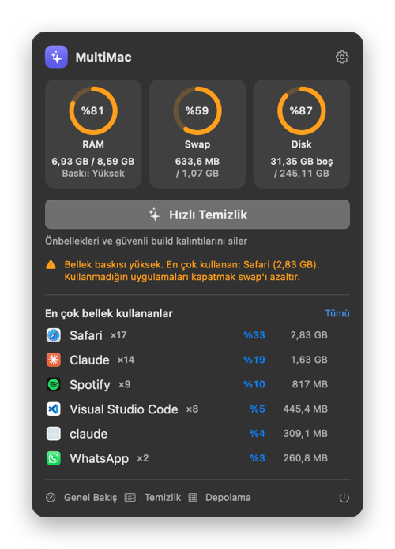
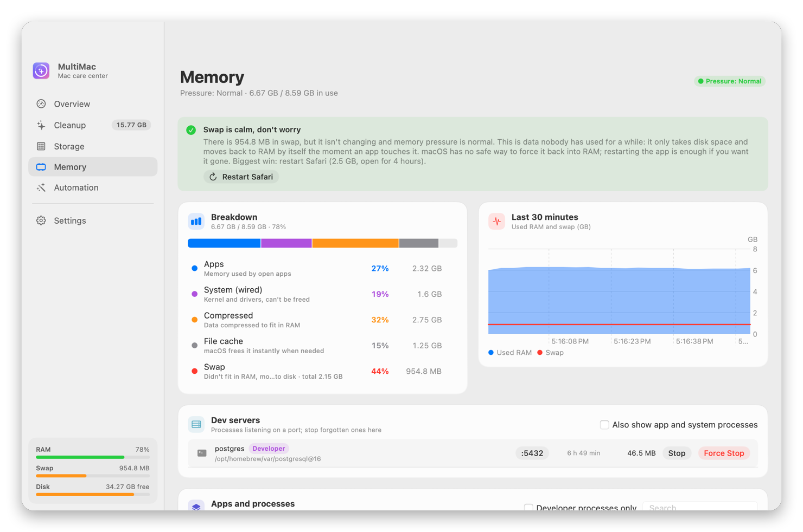
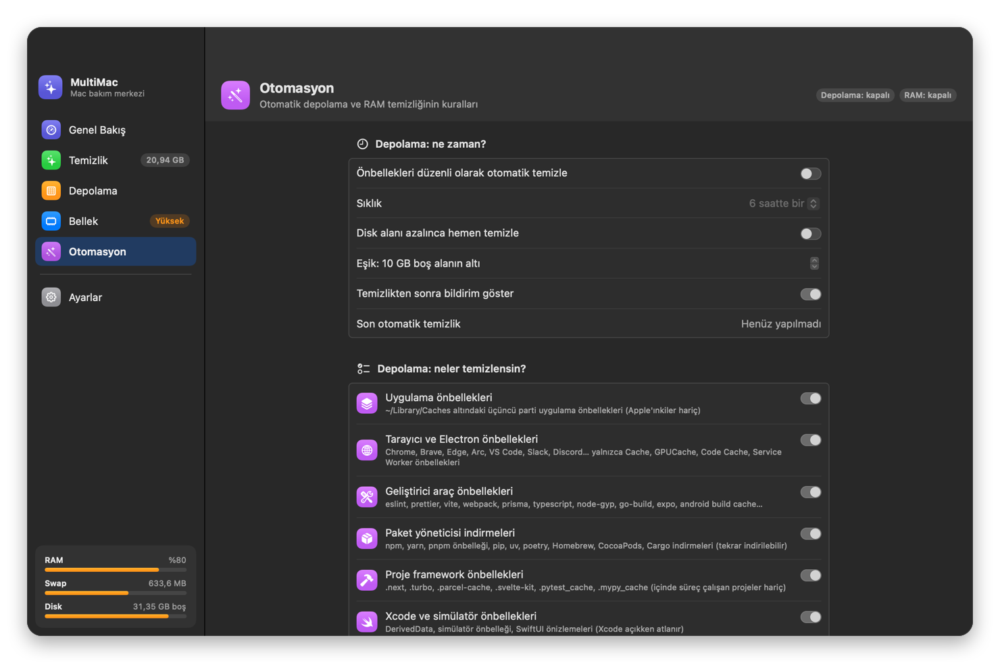

<p align="right"><b>English</b> · <a href="README.tr.md">Türkçe</a></p>

<p align="center">
  
</p>

<h1 align="center">MultiMac</h1>

<p align="center">
  <b>A native, lightweight maintenance app for small Macs.</b><br>
  Quick clean from the menu bar, rule-based cache cleanup, a SpaceSniffer-style storage map and an honest memory manager
  — built for an 8 GB / 256 GB MacBook.
</p>

<p align="center">
  
  
  
  
  
  
  <a href="LICENSE"></a>
</p>

<p align="center">
  
</p>

> [!NOTE]
> The app's interface is currently in **Turkish**. Screenshots show the Turkish UI; every screen is explained below.

---

## Contents

- [Why](#why)
- [Features](#features)
- [Screenshots](#screenshots)
- [Automation rules](#automation-rules)
- [RAM: why there is no "RAM cleaner"](#ram-why-there-is-no-ram-cleaner)
- [Safety model](#safety-model)
- [Installation](#installation)
- [Opening an unsigned app (Gatekeeper)](#opening-an-unsigned-app-gatekeeper)
- [Permissions](#permissions)
- [Usage](#usage)
- [How it works](#how-it-works)
- [Performance](#performance)
- [Limitations](#limitations)
- [Building from source](#building-from-source)
- [Project structure](#project-structure)
- [Credits](#credits)
- [License](#license)

---

## Why

On an 8 GB RAM / 256 GB SSD Mac, swap is almost always full and the disk keeps filling up with build leftovers:
`node_modules`, `.next`, `.venv`, npm / pip / Homebrew caches, browser caches… macOS's own storage screen lumps most of
it into *System Data*, and most "cleaner" apps are heavy, Electron-based or promise a fake "RAM boost".

MultiMac is the opposite: a small native app that shows exactly where space and memory go, cleans **caches, never
system files**, and stays out of the way in the menu bar.

## Features

| | |
| --- | --- |
| ⚡ **Menu bar quick clean** | One click scans and deletes everything the automation rules allow. Live RAM / swap / disk tiles and the top memory-hungry apps with a quit button. Icon-only by default so it never hides behind the notch. |
| 📊 **Overview** | Health summary with reasons, big RAM / swap / disk gauges, *where is the disk going?* (Library, Applications, Projects, dev tools, Downloads…), cleanable space per category and preset, memory breakdown, biggest projects and running dev servers. **Every percentage is clickable** and opens the right screen, filtered. |
| 🧹 **Detailed cleanup** | App caches, developer caches, project build leftovers, Xcode, logs, downloads, large & old files, Trash. *Safe / Balanced / Aggressive* presets, per-project view, search, size & age filters, sorting, expand an item to pick sub-folders, delete permanently or move to Trash. |
| 🗺️ **Storage map** | SpaceSniffer-style nested treemap of the whole disk, your home or any folder. Color-coded safety (system / caution / safe / yours) and a strong warning before deleting anything protected. Explains *System Data*. |
| 🧠 **Memory manager** | Apps grouped with their helper processes, 30-minute RAM & swap chart, quit / force quit, protected apps, alerts for swap %, critical pressure and apps above a limit. |
| 🛰️ **Dev server finder** | Every process listening on a TCP port with project folder, port (opens `localhost`), uptime and memory — find the `npm run dev` you forgot three days ago. |
| 🤖 **Automation** | Eight cache rules you can toggle one by one, a schedule, low-disk trigger, *what would be deleted?* preview, and optional RAM relief that closes the apps you chose when memory stays tight. |
| 🛡️ **Never touch list** | Right-click any item or whole project to exclude it forever. Respected by every scan, preset, the automation and the deletion engine itself. |
| 🪶 **Tiny footprint** | Native SwiftUI, ~55 MB RAM, < 1 % CPU when idle. No root, no helper, no background daemon. Builds without Xcode. |

## Screenshots

### Menu bar

<p align="center">
  
</p>

The menu bar icon turns into a warning when memory pressure is high. The panel shows RAM / swap / disk (each tile opens
the related screen), **Quick Clean** with the result of the last run, a plain-language memory tip and the apps using the
most memory with their share of RAM. Hover a row to quit the app; click it to open its details.

### Overview

The screenshot at the top. *Disk nereye gidiyor?* ("where is the disk going?") measures the main folders and shows each
as a share of the disk; *Temizlenebilir alan* ("cleanable space") shows what each preset would free. Click a row to jump
to the storage map or cleanup list for exactly that item.

### Detailed cleanup

<p align="center">
  
</p>

| Label | Meaning |
| --- | --- |
| **Kip: Güvenli / Dengeli / Agresif** | Preset: *Safe* (only automation-eligible caches) · *Balanced* (+ Xcode data, installers, leftovers of projects untouched for 30+ days) · *Aggressive* (+ every `node_modules`, `.venv`, build output and Trash; never items in use, old downloads, large files or unknown data) |
| **Kategoriler / Projeler** | Group by category, or by project (`node_modules + .next + dist`) |
| **Boyut · Yaş · Sırala · Seçililer** | Size filter · age filter · sort · show selected only |
| **Silme: Kalıcı sil / Çöp Kutusuna taşı** | Delete permanently / move to Trash (recoverable) |
| **Otomatik** badge | Will also be cleaned by the automation |

### Storage map

<p align="center">
  
</p>

Each block is a folder or file, sized by the space it takes; double-click to dive in, the breadcrumb goes back.
Colors: 🟩 *Silinebilir* safe to delete (caches, `node_modules`…) · 🟦 *Kullanıcı dosyası* your files ·
🟧 *Dikkat* app data / settings · 🟥 *Sistem / Korunan* system or protected. The inspector shows the reason for the
color, Finder / delete actions and the folder's contents.

### Memory

<p align="center">
  
</p>

### Automation

<p align="center">
  
</p>

## Automation rules

All automatic behaviour lives in the **Otomasyon** tab, and every rule can be switched off:

| Rule | What it deletes |
| --- | --- |
| App caches | Third-party caches in `~/Library/Caches` (never Apple's) |
| Browser & Electron caches | Only `Cache`, `Code Cache`, `GPUCache`, `ShaderCache`, `Service Worker` caches and `Crashpad/completed` of Chrome, Brave, Edge, Arc, Vivaldi, VS Code, Slack, Discord… **History, cookies and passwords are never touched.** |
| Developer tool caches | eslint, prettier, vite, webpack, prisma, typescript, node-gyp, go-build, expo, Android build cache, kube, docker buildx… (~40 tools) |
| Package manager downloads | npm, yarn, pnpm, pip, uv, poetry, Homebrew, CocoaPods, Cargo, gem, composer |
| Project framework caches | `.next`, `.turbo`, `.parcel-cache`, `.svelte-kit`, `.pytest_cache`, `.mypy_cache` — skipped while any process runs inside the project |
| Xcode & simulator caches | DerivedData, CoreSimulator caches, SwiftUI previews — skipped while Xcode or Simulator runs |
| Old logs & crash reports | Files in `~/Library/Logs` older than N days (default 7) |
| Old saved window states | `~/Library/Saved Application State` older than 30 days |

- Schedule from hourly to weekly, plus *clean now when free space drops below X GB*.
- *Skip caches of running apps* (on by default).
- **Preview** lists exactly what would be deleted and how much, without deleting anything.

**Never deleted automatically:** system folders, Apple caches, app data and settings, browser history / cookies /
passwords, `node_modules`, `.venv`, Downloads, large files, Trash and your *Never touch* list.

## RAM: why there is no "RAM cleaner"

Commands like `purge` only drop the file cache that macOS frees on its own the moment an app needs memory; they need
root and make the system slower for a while. [Mole](https://github.com/tw93/Mole) removed its swap / memory tweaks for
the same reason ("direct virtual memory operations pose system crash risk").

The only safe way to actually free memory is to close apps you are not using. MultiMac makes that easy and, optionally,
automatic:

- **See it:** pressure, swap, a 30-minute chart, and apps grouped with all their helper processes.
- **Act on it:** quit or force quit from the menu bar or the Memory tab; stop forgotten dev servers.
- **RAM relief (off by default):** when memory pressure (or swap) stays high for *N* minutes, gracefully quit the apps
  *you* listed that have been in the background for at least *M* minutes. Apps can still ask to save documents; the
  frontmost app and protected apps are never closed; every action is logged and can send a notification.

## Safety model

MultiMac errs on the side of not deleting:

1. **Allow-listed targets.** Automation only deletes known cache locations, and deletes their *contents*, not the
   folders apps expect to exist.
2. **In-use guard.** Caches of running apps, DerivedData while Xcode runs and `.next` while a dev server runs are skipped.
3. **Final gate in the deletion engine.** Only paths inside your home folder can be deleted; top-level folders
   (`~/Library`, `~/Documents`, …) can never be removed as a whole; *Never touch* paths are rechecked right before
   deletion, and a folder that contains an excluded path is not removed.
4. **Age limits** for logs and saved window states.
5. **Safety classifier** in the storage map marks system, app-data and personal paths before you can delete them.

## Installation

### Requirements

- macOS 15 Sequoia or later, Apple silicon
- Xcode **Command Line Tools** (`xcode-select --install`). Xcode itself is **not** needed.

### Build and install

```bash
git clone https://github.com/dormhi/multimac_tools.git
cd multimac_tools
./scripts/build.sh --install
```

This compiles the app, copies it to `/Applications/MultiMac.app` and launches it. The main window opens and the icon
appears in the menu bar; keep it in the Dock with *right-click › Options › Keep in Dock*.

<p align="center"></p>

## Opening an unsigned app (Gatekeeper)

MultiMac is ad-hoc signed and not notarised. When you build it yourself it opens normally. If you copy a built
`MultiMac.app` from another Mac and macOS says it *can't be opened*:

1. *System Settings › Privacy & Security* → scroll down → **Open Anyway**, or
2. remove the quarantine flag:

```bash
xattr -dr com.apple.quarantine /Applications/MultiMac.app
```

## Permissions

- **Full Disk Access** (recommended) lets the storage map read the whole disk:
  *System Settings › Privacy & Security › Full Disk Access* → add `/Applications/MultiMac.app`, then relaunch.
- **Notifications** for automatic cleanup, memory alerts and RAM relief.
- macOS may ask once for access to Desktop, Documents, Downloads or other apps' data during a scan.

## Usage

| Where | What |
| --- | --- |
| `⌘1` … `⌘6` | Overview, Cleanup, Storage, Memory, Automation, Settings |
| Menu bar › **Hızlı Temizlik** | Run the automation rules now |
| Overview | Click any percentage to open that item in the storage map or cleanup list |
| Cleanup | Pick a preset or tick items, then **Temizle** (clean). Right-click › *Asla dokunma* (never touch) |
| Storage | Choose *Tüm Disk / Ev Klasörü / Klasör…*, scan, double-click blocks to dive in |
| Memory | Right-click an app › add to protected apps. *Durdur* stops a dev server |
| Automation | Toggle rules, set the schedule, **Şimdi ne silinir?** previews, **Şimdi çalıştır** runs |
| Settings | Project folders, stale-project threshold, large/old file thresholds, alerts, protected apps, menu bar style, launch at login |

## How it works

| Data | Source |
| --- | --- |
| Used memory, wired, compressed, cached | `host_statistics64` — same formula as Activity Monitor |
| Swap | `sysctl vm.swapusage` |
| Memory pressure | `sysctl kern.memorystatus_vm_pressure_level` |
| Per-app memory | `proc_pid_rusage` (`phys_footprint`); XPC helpers (e.g. WebKit tabs) are attributed to their owner with `responsibility_get_pid_responsible_for_pid` |
| Listening ports / dev servers | `proc_pidinfo` + `proc_pidfdinfo` (no `lsof`), working directory via `PROC_PIDVNODEPATHINFO` |
| Folder sizes | `fts(3)` with allocated size (`st_blocks`), hard links counted once |
| Disk free space | `URLResourceKey.volumeAvailableCapacity` |

## Performance

| | |
| --- | --- |
| Memory | ~55 MB (`phys_footprint`) with the window open |
| CPU when idle | < 1 % (3-second updates) |
| Cleanup scan | ~7 s for caches and build leftovers, ~17 s including the large-file search |
| Storage map | ~630 k files scanned in ~17 s, kept as ~16 k nodes in memory |

Small folders in the storage map are collapsed and rescanned on demand, views observe only the data they show, the
window's minimum-size computation is cut off so live updates don't re-layout the whole window, and long lists are lazy.

## Limitations

- Interface is Turkish only (for now).
- Ad-hoc signed, not notarised; meant to be built locally.
- No root helper: system-wide caches (`/Library/Caches`, `/private/var`) are shown but never cleaned.
- Apple silicon and macOS 15+ only.
- Rebuilding with the default ad-hoc signature resets Full Disk Access; sign with a stable identity to avoid it (below).

## Building from source

```bash
./scripts/build.sh            # → build/app.noindex/MultiMac.app
./scripts/build.sh --install  # also copy to /Applications and launch
DEBUG=1 ./scripts/build.sh    # faster, unoptimised build
SIGN_IDENTITY="MultiMac Local" ./scripts/build.sh --install   # keep permissions between builds
./scripts/make-icon.sh        # regenerate the icon (drawn in code)
```

`build.sh` compiles every file in `Sources/` with `swiftc` — no Xcode project, no SwiftPM — assembles the `.app` with
`Resources/Info.plist` and the icon, and signs it.

### Broken Command Line Tools?

Some CLT updates leave an old `usr/include/swift/module.modulemap` behind that clashes with the new `bridging.modulemap`
(`redefinition of module 'SwiftBridging'`) and also breaks SwiftPM. `build.sh` detects this and hides the stale file
with a VFS overlay, so no `sudo` is needed. Permanent fix:

```bash
sudo rm /Library/Developer/CommandLineTools/usr/include/swift/module.modulemap
```

### Debug flags

```bash
# Print memory, disk, processes, cleanup scan, presets, automation preview, dev servers and a storage scan.
# Deletes nothing.
/Applications/MultiMac.app/Contents/MacOS/MultiMac --selftest ~/Projects

# Render every tab and the menu bar panel to PNG (used for the screenshots in this README).
/Applications/MultiMac.app/Contents/MacOS/MultiMac --snapshot /tmp/multimac-shots
```

## Project structure

```
Sources/MultiMac/
├── App/        Entry point, AppState & navigation, --selftest / --snapshot
├── Core/       Memory, disk & process readers, dev server finder, alerts, RAM relief, overview data
├── Cleanup/    Models & automation rules, scanner, large-file finder, deletion engine & store
├── Storage/    fts(3) walker, disk scanner, safety classifier, treemap layout, storage store
└── UI/         Menu bar panel, main window, Overview, Cleanup, Storage, Memory, Automation, Settings, theme
Resources/      Info.plist, AppIcon.icns
scripts/        build.sh, make-icon.sh / .swift, toolchain-fix (VFS overlay for broken CLT)
docs/images/    README images
```

## Credits

- The automation's cache target lists, age limits and *caches, not system files* approach were informed by
  [Mole](https://github.com/tw93/Mole) by tw93 (MIT). No code was copied; MultiMac is an independent Swift implementation.
- Treemap layout: *Squarified Treemaps* — Bruls, Huijsing & van Wijk.

## License

[MIT](LICENSE)
