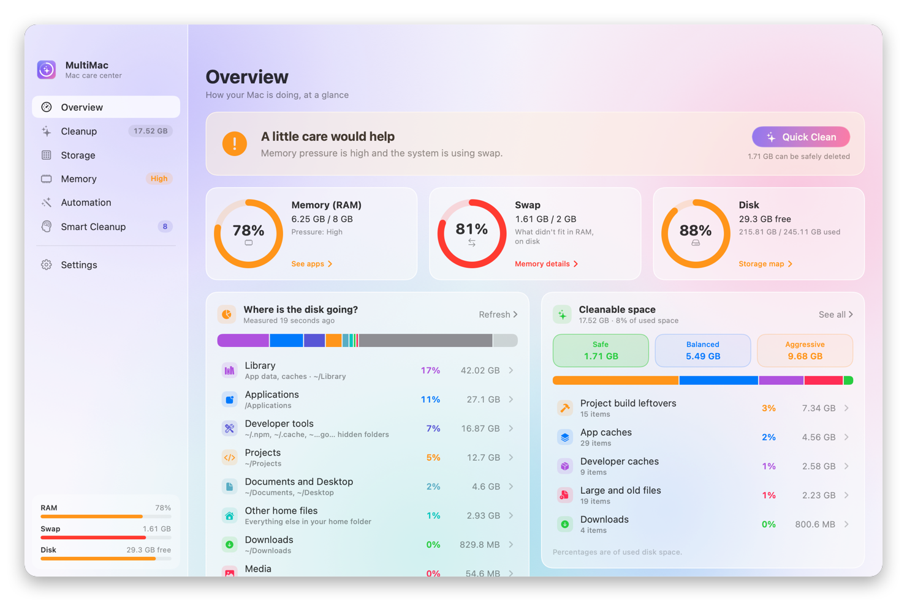
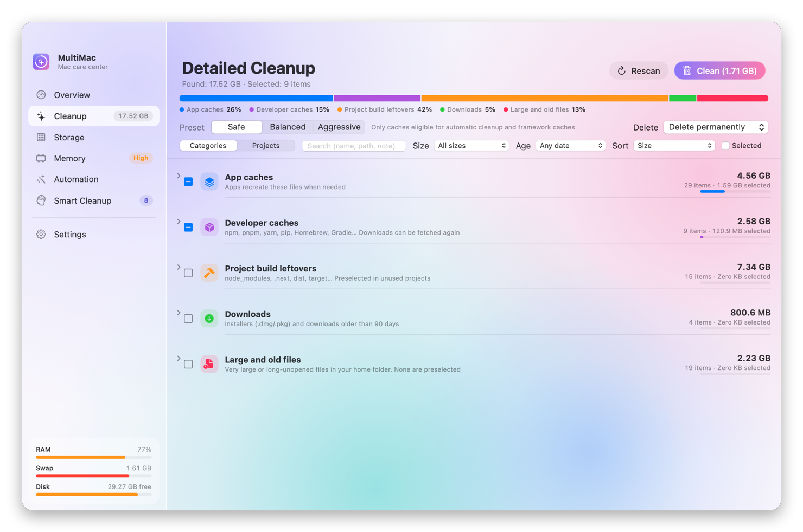
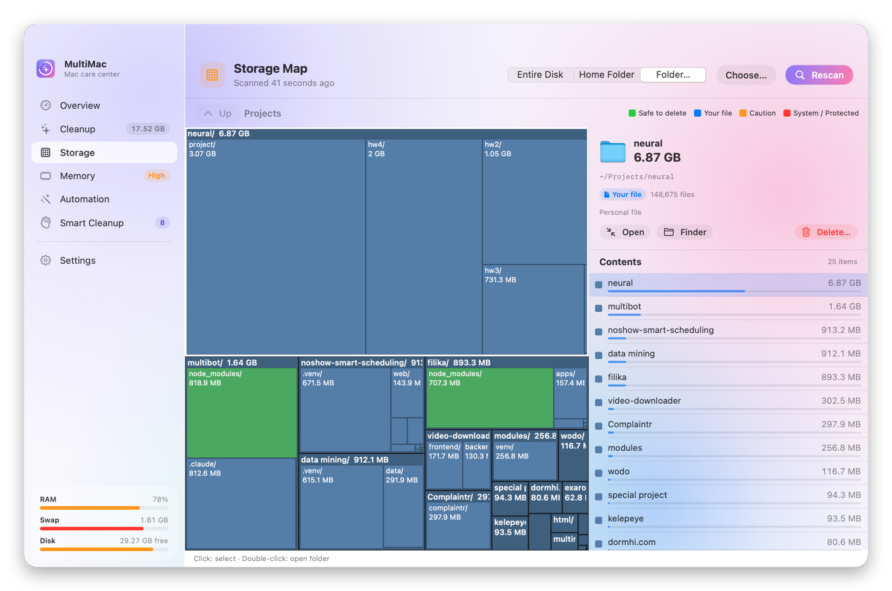
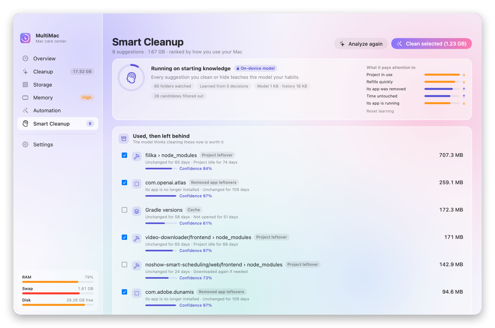

<p align="right"><b>English</b> · <a href="README.tr.md">Türkçe</a></p>

<p align="center">
  
</p>

<h1 align="center">MultiMac</h1>

<p align="center">
  <b>A native, lightweight maintenance app for small Macs.</b><br>
  Quick clean from the menu bar, rule-based cache cleanup, a small on-device model that learns what you leave behind,
  a SpaceSniffer-style storage map and an honest memory manager — built for an 8 GB / 256 GB MacBook.
</p>

<p align="center">
  
  
  
  
  
  
  <a href="LICENSE"></a>
</p>

<p align="center">
  
</p>

> [!NOTE]
> The interface is available in **English, Turkish and Russian**. These screenshots show the English UI in the light
> theme; the [Turkish README](README.tr.md) shows the Turkish UI in the dark theme.

---

## Contents

- [Why](#why)
- [Features](#features)
- [Screenshots](#screenshots)
- [Automation rules](#automation-rules)
- [Smart Cleanup: how it learns](#smart-cleanup-how-it-learns)
- [RAM: why there is no "RAM cleaner"](#ram-why-there-is-no-ram-cleaner)
- [Safety model](#safety-model)
- [Installation](#installation)
- [Opening an unsigned app (Gatekeeper)](#opening-an-unsigned-app-gatekeeper)
- [Permissions](#permissions)
- [Usage](#usage)
- [How it works](#how-it-works)
- [Performance](#performance)
- [Limitations](#limitations)
- [Building from source](#building-from-source)
- [Project structure](#project-structure)
- [Credits](#credits)
- [License](#license)

---

## Why

On an 8 GB RAM / 256 GB SSD Mac, swap is almost always full and the disk keeps filling up with build leftovers:
`node_modules`, `.next`, `.venv`, npm / pip / Homebrew caches, browser caches… macOS's own storage screen lumps most of
it into *System Data*, and most "cleaner" apps are heavy, Electron-based or promise a fake "RAM boost".

MultiMac is the opposite: a small native app that shows exactly where space and memory go, cleans **caches, never
system files**, and stays out of the way in the menu bar.

## Features

| | |
| --- | --- |
| ⚡ **Menu bar quick clean** | One click scans and deletes everything the automation rules allow. Live RAM / swap / disk tiles and the top memory-hungry apps with a quit button. Icon-only by default so it never hides behind the notch. |
| 📊 **Overview** | Health summary with reasons, big RAM / swap / disk gauges, *where is the disk going?* (Library, Applications, Projects, dev tools, Downloads…), cleanable space per category and preset, memory breakdown, biggest projects and running dev servers. **Every percentage is clickable** and opens the right screen, filtered. |
| 🧹 **Detailed cleanup** | App caches, developer caches, project build leftovers, Xcode, logs, downloads, large & old files, Trash. *Safe / Balanced / Aggressive* presets, per-project view, search, size & age filters, sorting, expand an item to pick sub-folders, delete permanently or move to Trash. |
| 🗺️ **Storage map** | SpaceSniffer-style nested treemap of the whole disk, your home or any folder. Color-coded safety (system / caution / safe / yours) and a strong warning before deleting anything protected. Explains *System Data*. |
| 🧠 **Memory manager** | Apps grouped with their helper processes, 30-minute RAM & swap chart, protected apps, alerts for swap %, critical pressure and apps above a limit. A plain-language **swap insight** tells you whether swap is actually hurting and which long-running app to **restart** to get memory back. Every action button is labeled: *Restart*, *Quit*, *Force Quit*. Memory is shown in 1024-based units like Activity Monitor, so 8 GB of RAM reads *8 GB*. |
| 🛰️ **Dev server finder** | Every process listening on a TCP port with project folder, port (opens `localhost`), uptime and memory — find the `npm run dev` you forgot three days ago. |
| 🤖 **Automation** | Eight cache rules you can toggle one by one, a schedule, low-disk trigger, *what would be deleted?* preview, and optional RAM relief that closes the apps you chose when memory stays tight. |
| ✨ **Smart Cleanup** | A tiny on-device model (~1 KB) ranks what you used and then left behind: idle projects' `node_modules`, leftovers of apps you removed, old Playwright / Node / Python / Homebrew / device-support versions, AI models you tried once. Every suggestion says *why* and how confident it is. It learns from what you clean, what you hide and whether cleaned folders come back. Caches that refill right away are flagged as not worth cleaning, and old-but-important files are never suggested. |
| 🛡️ **Never touch list** | Right-click any item or whole project to exclude it forever. Respected by every scan, preset, the automation and the deletion engine itself. |
| 🌓 **Glass look: Light, Dark or System** | Frosted glass cards and a translucent sidebar over a soft purple, pink and teal background, with gradient buttons for the main actions. The background is drawn once and the blur runs on the GPU, so it costs no extra CPU. Pick the theme in *Settings › Appearance and language*. The sidebar collapses into a slim icon rail instead of disappearing. |
| 🌐 **Turkish, English and Russian** | Follows your Mac's language (Turkish or Russian if macOS uses it, English otherwise) and can be switched in Settings at any time, no restart needed. |
| 🪶 **Tiny footprint** | Native SwiftUI, ~55 MB RAM, < 1 % CPU when idle. No root, no helper, no background daemon. Builds without Xcode. |

## Screenshots

### Menu bar

<p align="center">
  
</p>

The menu bar icon turns into a warning when memory pressure is high. The panel shows RAM / swap / disk (each tile opens
the related screen), **Quick Clean** with the result of the last run, a plain-language memory tip and the apps using the
most memory with their share of RAM. When swap is churning or memory is squeezed, a compact insight card appears with a
one-click restart of the app that would free the most. Hover a row to quit the app; click it to open its details.

### Overview

The screenshot at the top. *Where is the disk going?* measures the main folders and shows each as a share of the disk;
*Cleanable space* shows what each preset would free. Click a row to jump to the storage map or cleanup list for exactly
that item.

### Detailed cleanup

<p align="center">
  
</p>

| Label | Meaning |
| --- | --- |
| **Preset: Safe / Balanced / Aggressive** | *Safe*: only automation-eligible caches · *Balanced*: + Xcode data, installers, leftovers of projects untouched for 30+ days · *Aggressive*: + every `node_modules`, `.venv`, build output and Trash; never items in use, old downloads, large files or unknown data |
| **Categories / Projects** | Group by category, or by project (`node_modules + .next + dist`) |
| **Size · Age · Sort · Selected** | Size filter · age filter · sort · show selected only |
| **Delete: Delete permanently / Move to Trash** | Delete for good, or move to the Trash (recoverable) |
| **Auto** badge | Will also be cleaned by the automation |

### Storage map

<p align="center">
  
</p>

Each block is a folder or file, sized by the space it takes; double-click to dive in, the breadcrumb goes back.
Colors: 🟩 *Safe to delete* (caches, `node_modules`…) · 🟦 *Your file* · 🟧 *Caution* (app data / settings) ·
🟥 *System / Protected*. The inspector shows the reason for the
color, Finder / delete actions and the folder's contents.

### Memory

<p align="center">
  
</p>

The card at the top reads the situation in plain language:

| Card | When | What it suggests |
| --- | --- | --- |
| **Swap is churning** | More than ~0.75 GB moved in or out of swap in the last 5 minutes | Close or restart something now, this is what makes the Mac stutter |
| **Memory is tight** | Memory pressure is not normal | Restart the biggest app that has been open for 3+ hours |
| **Swap is calm** | Swap is in use but not moving | Nothing; idle pages on disk do not slow you down |

Every button says what it does, and the destructive ones are red. App buttons appear when you hover a row, which keeps the long process list light:

| Button | Where | What it does |
| --- | --- | --- |
| **Restart** | Apps | Quits the app gracefully, waits for it to exit, opens it again in the background. Its memory starts fresh and its swapped-out pages are dropped |
| **Quit** | Apps | Asks the app to quit, like ⌘Q. It can still ask to save documents |
| **Force Quit** | Apps | Kills the app and its helpers immediately (asks for confirmation; unsaved work is lost) |
| **Terminate** | Single helper process | Terminates just that process |
| **Stop** / **Force Stop** | Dev servers | Stops a server with `SIGTERM` / kills it with `SIGKILL` |

### Automation

<p align="center">
  
</p>

The tab holds exactly two jobs, each a card with one on/off switch and a plain question-and-answer rule:

- **Clean caches automatically**: *When?* (hourly … weekly, or no schedule) · *If the disk fills up?* (clean right away below 5–50 GB free) · *What?* (rule chips showing how much each would free; hover for details). The footer says when it runs next and what it did last; **What gets deleted?** lists exactly what would go, **Run now** runs it now.
- **Quit apps when memory is tight**: *When?* (pressure high / critical / swap above X %, for N minutes) · *Which apps?* (your list) · *Which of them?* (only those unused for N minutes). The footer shows whether the condition is met right now and who is next.

*Never touched*, *Advanced* (notifications, running apps, log age, cooldown) and *History* are folded away until you need them. Both jobs are **off by default**.

### Smart Cleanup

<p align="center">
  
</p>

- **Model card:** whether it is still on its starting knowledge or already learning, how many folders it watches, how
  many of your decisions it learned from, its size, and *what it pays attention to*: its strongest weights (indigo makes
  a suggestion more likely, orange less). *Reset learning* goes back to the starting weights.
- **Used, then left behind:** the suggestions. Each row has a reason line (*Project idle for 73 days*, *Its app is no
  longer installed*), a confidence bar, the size, and on hover **Don't suggest** and Finder. Homebrew and Ollama are
  removed with their own tools, so those rows offer **Copy command** (`brew cleanup`, `ollama rm …`) instead of a checkbox.
- **Refills quickly · not worth cleaning:** caches that came back within days of the last cleanup.
- **Untouched but looks important:** old folders with documents, photos or code, kinds you never accept, and
  information only: apps unopened for 120+ days, iPhone backups and Mail attachments. Never suggested.

## Automation rules

All automatic behaviour lives in the **Otomasyon** tab, and every rule can be switched off:

| Rule | What it deletes |
| --- | --- |
| App caches | Third-party caches in `~/Library/Caches` (never Apple's) |
| Browser & Electron caches | Only `Cache`, `Code Cache`, `GPUCache`, `ShaderCache`, `Service Worker` caches and `Crashpad/completed` of Chrome, Brave, Edge, Arc, Vivaldi, VS Code, Slack, Discord… **History, cookies and passwords are never touched.** |
| Developer tool caches | eslint, prettier, vite, webpack, prisma, typescript, node-gyp, go-build, expo, Android build cache, kube, docker buildx… (~40 tools) |
| Package manager downloads | npm, yarn, pnpm, pip, uv, poetry, Homebrew, CocoaPods, Cargo, gem, composer |
| Project framework caches | `.next`, `.turbo`, `.parcel-cache`, `.svelte-kit`, `.pytest_cache`, `.mypy_cache` — skipped while any process runs inside the project |
| Xcode & simulator caches | DerivedData, CoreSimulator caches, SwiftUI previews — skipped while Xcode or Simulator runs |
| Old logs & crash reports | Files in `~/Library/Logs` older than N days (default 7) |
| Old saved window states | `~/Library/Saved Application State` older than 30 days |

- Schedule from hourly to weekly, plus *clean now when free space drops below X GB*.
- *Skip caches of running apps* (on by default).
- **Preview** lists exactly what would be deleted and how much, without deleting anything.

**Never deleted automatically:** system folders, Apple caches, app data and settings, browser history / cookies /
passwords, `node_modules`, `.venv`, Downloads, large files, Trash and your *Never touch* list.

## Smart Cleanup: how it learns

It is machine learning in the plainest form that works on one person's data: **logistic regression**, about 15 weights
plus one starting bias per kind of suggestion. No neural network, no Core ML, no download, no cloud.

| Part | What it is |
| --- | --- |
| Features | Days unchanged, days unopened (or *unknown*), size, growth this week, *grew fast then stopped*, *refilled after cleaning*, app removed / app running, project idle / project busy, a newer version exists, can be downloaded again, you cleaned it before |
| Starting point | Weights tuned by hand from the cleanup rules, so it gives sensible suggestions on day one |
| Learns from | Cleaning a suggestion (yes) · **Don't suggest** (no, and that path is muted) · a cleaned folder refilling within 7 days (no) · a cleaned folder not coming back for 30 days (yes) |
| Guard rails | Each update is small and pulled back toward the starting weights, so one click can't wreck it |
| Memory | Model ~1 KB; size history (up to 45 samples per path) is a few tens of KB on disk and loaded only while analysing |
| When it runs | When you open the tab (at most every 6 hours), after regular and quick cleanups, and once a day in the background via the automation check. No daemon |
| Explanations | The reason line comes from the features that pushed the score up the most |

New sources it looks at, beyond the regular cleanup scan:

- **Leftovers of removed apps:** reverse-DNS folders (`com.vendor.app`) in Application Support, Caches, HTTPStorages,
  WebKit, Logs and Saved Application State whose app is no longer installed and that have been untouched for 30+ days.
  Folders named after the app (`Spotify`) are skipped because they are ambiguous; `~/Library/Containers` is skipped
  because reading it triggers a macOS privacy prompt.
- **Old versions:** Playwright browsers with a newer revision, nvm Node and pyenv Python versions (the default / global
  one, versions pinned in your projects' `.nvmrc` / `.python-version` and pyenv versions with virtualenvs are kept),
  Xcode device support for older iOS versions, simulators whose runtime is gone, old Homebrew Cellar versions.
- **AI models:** Hugging Face models and datasets, LM Studio, Whisper, PyTorch Hub and Ollama models.
- **Information only:** apps unopened for 120+ days (from macOS's *last used* date), iPhone backups, Mail attachments
  (with Full Disk Access).

macOS's *last used* date is not always updated, so a missing value counts as *unknown*, never as *never used*. It takes
a week or two of history before *grew fast then stopped* and *refills quickly* have anything to work with.

## RAM: why there is no "RAM cleaner"

Commands like `purge` only drop the file cache that macOS frees on its own the moment an app needs memory; they need
root and make the system slower for a while. [Mole](https://github.com/tw93/Mole) removed its swap / memory tweaks for
the same reason ("direct virtual memory operations pose system crash risk").

The only safe way to actually free memory is to close apps you are not using. MultiMac makes that easy and, optionally,
automatic:

- **See it:** pressure, swap, a 30-minute chart, and apps grouped with all their helper processes.
- **Act on it:** restart, quit or force quit from the menu bar or the Memory tab; stop forgotten dev servers.
- **RAM relief (off by default):** when memory pressure (or swap) stays high for *N* minutes, gracefully quit the apps
  *you* listed that have been in the background for at least *M* minutes. Apps can still ask to save documents; the
  frontmost app and protected apps are never closed; every action is logged and can send a notification.

### Can swap be moved back into RAM?

Not from an app, and not safely. macOS pages swapped-out memory back in only when the owning process touches it again;
there is no public API to force it, and tricks like disabling the pager or allocating memory to provoke paging need
root and make things worse. Swap that sits still costs nothing but disk space.

What works: **restart the app that owns it.** Its swapped-out pages are thrown away and it comes back with a fresh,
smaller footprint. The swap insight card points to the best candidate (the biggest app open for 3+ hours), and
**Yeniden Başlat** does it in one click. A full macOS restart clears swap completely.

## Safety model

MultiMac errs on the side of not deleting:

1. **Allow-listed targets.** Automation only deletes known cache locations, and deletes their *contents*, not the
   folders apps expect to exist.
2. **In-use guard.** Caches of running apps, DerivedData while Xcode runs and `.next` while a dev server runs are skipped.
3. **Final gate in the deletion engine.** Only paths inside your home folder can be deleted; top-level folders
   (`~/Library`, `~/Documents`, …) can never be removed as a whole; *Never touch* paths are rechecked right before
   deletion, and a folder that contains an excluded path is not removed.
4. **Age limits** for logs and saved window states.
5. **Safety classifier** in the storage map marks system, app-data and personal paths before you can delete them.
6. **Smart Cleanup only suggests.** Its suggestions come only from paths the deletion engine's final gate allows,
   personal-looking folders are never suggested, and nothing is deleted until you confirm.

## Installation

### Requirements

- macOS 15 Sequoia or later, Apple silicon
- Xcode **Command Line Tools** (`xcode-select --install`). Xcode itself is **not** needed.

### Build and install

```bash
git clone https://github.com/dormhi/multimac_tools.git
cd multimac_tools
./scripts/build.sh --install
```

This compiles the app, copies it to `/Applications/MultiMac.app` and launches it. The main window opens and the icon
appears in the menu bar; keep it in the Dock with *right-click › Options › Keep in Dock*.

<p align="center"></p>

## Opening an unsigned app (Gatekeeper)

MultiMac is ad-hoc signed and not notarised. When you build it yourself it opens normally. If you copy a built
`MultiMac.app` from another Mac and macOS says it *can't be opened*:

1. *System Settings › Privacy & Security* → scroll down → **Open Anyway**, or
2. remove the quarantine flag:

```bash
xattr -dr com.apple.quarantine /Applications/MultiMac.app
```

## Permissions

- **Full Disk Access** (recommended) lets the storage map read the whole disk:
  *System Settings › Privacy & Security › Full Disk Access* → add `/Applications/MultiMac.app`, then relaunch.
- **Notifications** for automatic cleanup, memory alerts and RAM relief.
- macOS may ask once for access to Desktop, Documents, Downloads or other apps' data during a scan.

## Usage

| Where | What |
| --- | --- |
| `⌘1` … `⌘7` | Overview, Cleanup, Storage, Memory, Automation, Smart Cleanup, Settings |
| `⌃⌘S` or the sidebar button | Collapse the sidebar to an icon rail and back |
| Menu bar › **Quick Clean** | Run the automation rules now |
| Overview | Click any percentage to open that item in the storage map or cleanup list |
| Cleanup | Pick a preset or tick items, then **Clean**. Right-click › *Never touch* |
| Storage | Choose *Entire Disk / Home Folder / Folder…*, scan, double-click blocks to dive in |
| Memory | *Restart* restarts an app, *Quit* quits, *Force Quit* force quits. Right-click an app › add to protected apps. *Stop* stops a dev server |
| Automation | Turn a job on, answer its questions, click chips to pick what gets cleaned. **What gets deleted?** previews, **Run now** runs |
| Smart Cleanup | Tick suggestions and **Clean selected**, or **Don't suggest** to teach it. **Analyze again** rescans |
| Settings | Project folders, stale-project threshold, large/old file thresholds, alerts, protected apps, menu bar style, launch at login |

## How it works

| Data | Source |
| --- | --- |
| Used memory, wired, compressed, cached | `host_statistics64` — same formula as Activity Monitor, shown in 1024-based units like Activity Monitor (disk sizes use 1000-based units like Finder) |
| Swap | `sysctl vm.swapusage` |
| Memory pressure | `sysctl kern.memorystatus_vm_pressure_level` |
| Per-app memory | `proc_pid_rusage` (`phys_footprint`); XPC helpers (e.g. WebKit tabs) are attributed to their owner with `responsibility_get_pid_responsible_for_pid` |
| Listening ports / dev servers | `proc_pidinfo` + `proc_pidfdinfo` (no `lsof`), working directory via `PROC_PIDVNODEPATHINFO` |
| Folder sizes | `fts(3)` with allocated size (`st_blocks`), hard links counted once |
| Disk free space | `URLResourceKey.volumeAvailableCapacity` |
| Last used date (Smart Cleanup) | Spotlight `kMDItemLastUsedDate`, falling back to the newest access / modification time of the files |

## Performance

| | |
| --- | --- |
| Memory | ~55 MB (`phys_footprint`) with the window open |
| CPU when idle | < 1 % (3-second updates) |
| Cleanup scan | ~7 s for caches and build leftovers, ~17 s including the large-file search |
| Storage map | ~630 k files scanned in ~17 s, kept as ~16 k nodes in memory |
| Smart Cleanup | ~60 candidates analysed in ~17 s; model ~1 KB, history ~11 KB on disk |

Small folders in the storage map are collapsed and rescanned on demand, views observe only the data they show, the
window's minimum-size computation is cut off so live updates don't re-layout the whole window, and long lists are lazy.

## Limitations

- Smart Cleanup needs a week or two of history before it can tell refilling caches from abandoned folders.
- Ad-hoc signed, not notarised; meant to be built locally.
- No root helper: system-wide caches (`/Library/Caches`, `/private/var`) are shown but never cleaned.
- Apple silicon and macOS 15+ only.
- Rebuilding with the default ad-hoc signature resets Full Disk Access; sign with a stable identity to avoid it (below).

## Building from source

```bash
./scripts/build.sh            # → build/app.noindex/MultiMac.app
./scripts/build.sh --install  # also copy to /Applications and launch
DEBUG=1 ./scripts/build.sh    # faster, unoptimised build
SIGN_IDENTITY="MultiMac Local" ./scripts/build.sh --install   # keep permissions between builds
./scripts/make-icon.sh        # regenerate the icon (drawn in code)
```

`build.sh` compiles every file in `Sources/` with `swiftc` — no Xcode project, no SwiftPM — assembles the `.app` with
`Resources/Info.plist` and the icon, and signs it.

### Broken Command Line Tools?

Some CLT updates leave an old `usr/include/swift/module.modulemap` behind that clashes with the new `bridging.modulemap`
(`redefinition of module 'SwiftBridging'`) and also breaks SwiftPM. `build.sh` detects this and hides the stale file
with a VFS overlay, so no `sudo` is needed. Permanent fix:

```bash
sudo rm /Library/Developer/CommandLineTools/usr/include/swift/module.modulemap
```

### Debug flags

```bash
# Print memory, disk, processes, cleanup scan, presets, automation preview, dev servers and a storage scan.
# Deletes nothing.
/Applications/MultiMac.app/Contents/MacOS/MultiMac --selftest ~/Projects

# Print only the Smart Cleanup analysis: candidates, scores, sections and reasons. Deletes nothing.
/Applications/MultiMac.app/Contents/MacOS/MultiMac --selftest --smart

# Render every tab and the menu bar panel to PNG (used for the screenshots in this README).
/Applications/MultiMac.app/Contents/MacOS/MultiMac --snapshot /tmp/multimac-shots

# Open the main window on a given tab (overview, cleanup, storage, memory, automation, smart, settings), e.g. for profiling with `sample`.
/Applications/MultiMac.app/Contents/MacOS/MultiMac --tab memory
```

## Project structure

```
Sources/MultiMac/
├── App/        Entry point, AppState & navigation, --selftest / --snapshot
├── Core/       Memory, disk & process readers, dev server finder, alerts, RAM relief, overview data
├── Cleanup/    Models & automation rules, scanner, large-file finder, deletion engine & store
├── Storage/    fts(3) walker, disk scanner, safety classifier, treemap layout, storage store
├── Smart/      Smart Cleanup: features & model, size history, detectors, analysis & feedback store
└── UI/         Menu bar panel, main window, Overview, Cleanup, Storage, Memory, Automation, Smart Cleanup, Settings, theme
Resources/      Info.plist, AppIcon.icns
scripts/        build.sh, make-icon.sh / .swift, toolchain-fix (VFS overlay for broken CLT)
docs/images/    README images (English, light theme; tr/ holds the Turkish, dark theme set)
```

## Credits

- The automation's cache target lists, age limits and *caches, not system files* approach were informed by
  [Mole](https://github.com/tw93/Mole) by tw93 (MIT). No code was copied; MultiMac is an independent Swift implementation.
- Treemap layout: *Squarified Treemaps* — Bruls, Huijsing & van Wijk.

## License

[MIT](LICENSE)
