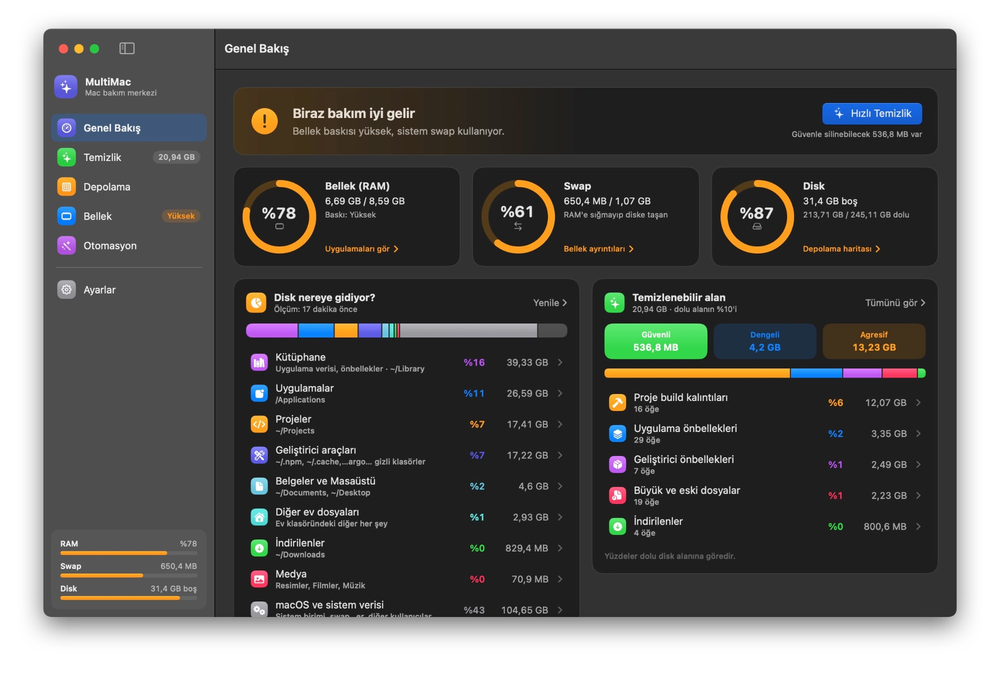
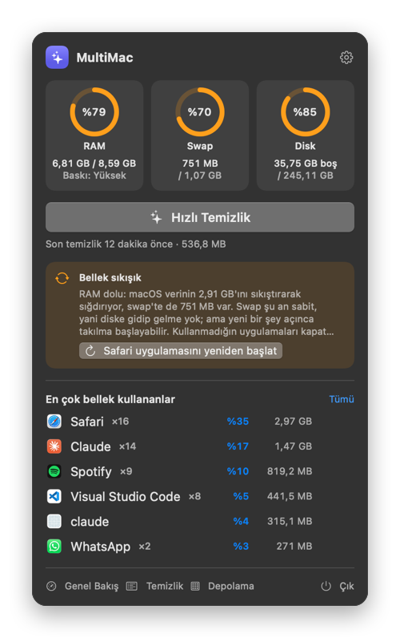
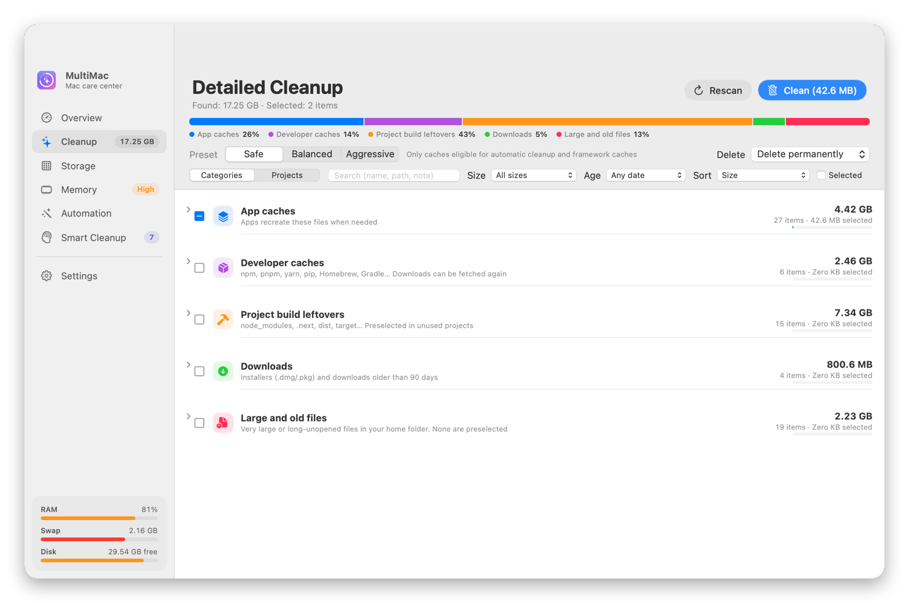
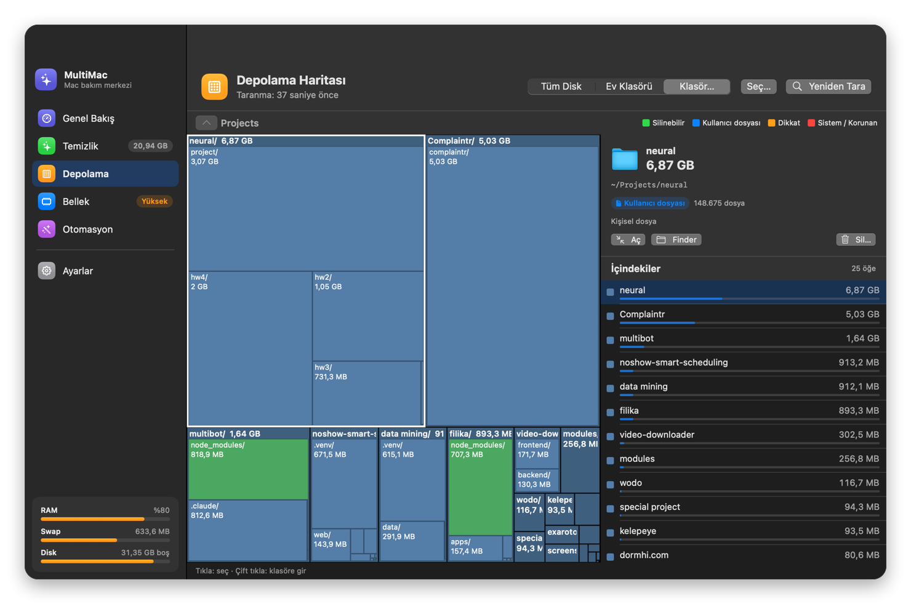
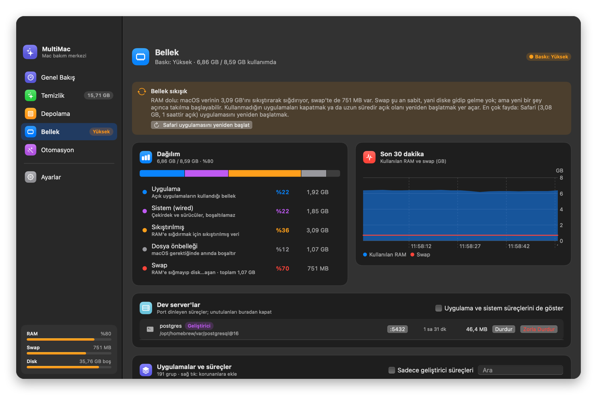
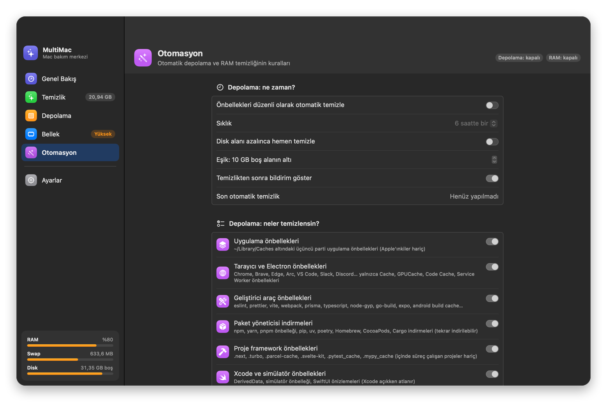
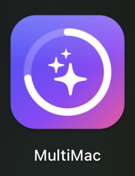

<p align="right"><a href="README.md">English</a> · <b>Türkçe</b></p>

<p align="center">
  
</p>

<h1 align="center">MultiMac</h1>

<p align="center">
  <b>Küçük Mac'ler için yerel ve hafif bir bakım uygulaması.</b><br>
  Menü çubuğundan hızlı temizlik, kural bazlı önbellek temizliği, SpaceSniffer tarzı depolama haritası ve dürüst bir
  bellek yöneticisi — 8 GB / 256 GB bir MacBook için yazıldı.
</p>

<p align="center">
  
  
  
  
  
  
  <a href="LICENSE"></a>
</p>

<p align="center">
  
</p>

---

## İçindekiler

- [Neden?](#neden)
- [Özellikler](#özellikler)
- [Ekran görüntüleri](#ekran-görüntüleri)
- [Otomasyon kuralları](#otomasyon-kuralları)
- [RAM: neden "RAM temizleyici" yok?](#ram-neden-ram-temizleyici-yok)
- [Güvenlik modeli](#güvenlik-modeli)
- [Kurulum](#kurulum)
- [Gatekeeper: imzasız uygulamayı açmak](#gatekeeper-imzasız-uygulamayı-açmak)
- [Gerekli izinler](#gerekli-izinler)
- [Kullanım](#kullanım)
- [Nasıl çalışır?](#nasıl-çalışır)
- [Performans](#performans)
- [Sınırlamalar](#sınırlamalar)
- [Kaynaktan derleme](#kaynaktan-derleme)
- [Proje yapısı](#proje-yapısı)
- [Teşekkürler](#teşekkürler)
- [Lisans](#lisans)

---

## Neden?

8 GB RAM / 256 GB SSD bir Mac'te swap neredeyse hep doludur ve disk build kalıntılarıyla dolmaya devam eder:
`node_modules`, `.next`, `.venv`, npm / pip / Homebrew önbellekleri, tarayıcı önbellekleri… macOS'un kendi depolama ekranı
bunların çoğunu *Sistem Verisi* altına toplar; çoğu "temizleyici" uygulama da ağırdır, Electron tabanlıdır ya da sahte
bir "RAM hızlandırma" vaat eder.

MultiMac bunun tersi: alanın ve belleğin tam olarak nereye gittiğini gösteren, **sistem dosyalarına değil yalnızca
önbelleklere** dokunan ve menü çubuğunda sessizce duran küçük, yerel bir uygulama.

## Özellikler

| | |
| --- | --- |
| ⚡ **Menü çubuğundan hızlı temizlik** | Tek tıkla otomasyon kurallarının izin verdiği her şeyi tarar ve siler. Canlı RAM / swap / disk kutuları ve kapatma butonuyla en çok bellek kullanan uygulamalar. Varsayılan olarak yalnızca simge; çentiğin arkasında kaybolmaz. |
| 📊 **Genel Bakış** | Nedenleriyle sağlık özeti, büyük RAM / swap / disk göstergeleri, *disk nereye gidiyor?* (Kütüphane, Uygulamalar, Projeler, geliştirici araçları, İndirilenler…), kategori ve kipe göre temizlenebilir alan, bellek dağılımı, en büyük projeler ve çalışan dev server'lar. **Her yüzde tıklanabilir** ve doğru ekranı, filtrelenmiş olarak açar. |
| 🧹 **Detaylı temizlik** | Uygulama önbellekleri, geliştirici önbellekleri, proje build kalıntıları, Xcode, günlükler, İndirilenler, büyük ve eski dosyalar, Çöp Kutusu. *Güvenli / Dengeli / Agresif* kipleri, proje görünümü, arama, boyut ve yaş filtreleri, sıralama, alt klasörleri tek tek seçme, kalıcı silme veya Çöp Kutusuna taşıma. |
| 🗺️ **Depolama haritası** | Tüm diskin, ev klasörünün veya herhangi bir klasörün SpaceSniffer tarzı iç içe treemap'i. Renkli güvenlik işaretleri (sistem / dikkat / silinebilir / senin) ve korunan bir şeyi silmeden önce güçlü uyarı. *Sistem Verisi*ni açıklar. |
| 🧠 **Bellek yöneticisi** | Yardımcı süreçleriyle gruplanmış uygulamalar, 30 dakikalık RAM ve swap grafiği, korunan uygulamalar, swap yüzdesi, kritik baskı ve sınırı aşan uygulamalar için uyarılar. Sade dilli **swap yorumu** swap'in gerçekten sorun olup olmadığını ve belleği geri almak için uzun süredir açık hangi uygulamayı **yeniden başlatman** gerektiğini söyler. Her tuşun üzerinde ne yaptığı yazar: *Yeniden Başlat*, *Kapat*, *Zorla Kapat*. |
| 🛰️ **Dev server bulucu** | TCP portu dinleyen her süreç; proje klasörü, port (`localhost`'u açar), çalışma süresi ve bellekle. Üç gün önce unuttuğun `npm run dev`'i bul. |
| 🤖 **Otomasyon** | Tek tek açılıp kapatılabilen sekiz önbellek kuralı, zamanlama, disk azalınca tetikleme, *ne silinir?* önizlemesi ve bellek sıkıştığında senin seçtiğin uygulamaları kapatan isteğe bağlı RAM rahatlatma. |
| 🛡️ **Asla dokunma listesi** | Bir öğeye veya projenin tamamına sağ tıklayıp kalıcı olarak hariç tut. Her tarama, kip, otomasyon ve silme motorunun kendisi buna uyar. |
| 🪶 **Hafif** | Yerel SwiftUI, ~55 MB RAM, boştayken < %1 CPU. Root yok, yardımcı yok, arka plan servisi yok. Xcode olmadan derlenir. |

## Ekran görüntüleri

### Menü çubuğu

<p align="center">
  
</p>

Bellek baskısı yükselince menü çubuğundaki ikon uyarı simgesine dönüşür. Panelde RAM / swap / disk (her kutu ilgili
ekranı açar), son çalışmanın sonucuyla **Hızlı Temizlik**, sade bir bellek önerisi ve RAM payıyla birlikte en çok
bellek kullanan uygulamalar var. Swap çalkantılıysa veya bellek sıkışıksa, en çok yer açacak uygulamayı tek tıkla
yeniden başlatan küçük bir yorum kartı çıkar. Satırın üzerine gelince uygulamayı kapatabilir, tıklayınca ayrıntısını açabilirsin.

### Genel Bakış

En üstteki görüntü. *Disk nereye gidiyor?* ana klasörleri ölçer ve her birini diskin yüzdesi olarak gösterir;
*Temizlenebilir alan* her kipin ne kadar yer açacağını gösterir. Bir satıra tıklayınca tam o öğe için depolama
haritasına veya temizlik listesine gidersin.

### Detaylı temizlik

<p align="center">
  
</p>

- **Kip:** *Güvenli* (yalnızca otomasyona uygun önbellekler) · *Dengeli* (+ Xcode verisi, kurulum dosyaları, 30+ gündür
  dokunulmayan projelerin kalıntıları) · *Agresif* (+ tüm `node_modules`, `.venv`, build çıktıları ve Çöp Kutusu;
  kullanımdaki öğeler, eski indirmeler, büyük dosyalar ve tanınmayan veriler asla).
- **Kategoriler / Projeler:** kategoriye veya projeye göre (`node_modules + .next + dist`) gruplama.
- **Otomatik** etiketi: bu öğe otomasyon tarafından da temizlenir.

### Depolama haritası

<p align="center">
  
</p>

Her blok bir klasör veya dosya; büyüklüğü kapladığı alanla orantılı. Çift tıklayınca içine girersin, üstteki yol
çubuğuyla geri dönersin. Renkler: 🟩 silinebilir (önbellekler, `node_modules`…) · 🟦 senin dosyaların ·
🟧 dikkat (uygulama verisi / ayarlar) · 🟥 sistem veya korunan. İnceleme paneli rengin nedenini, Finder / silme
işlemlerini ve klasörün içeriğini gösterir.

### Bellek

<p align="center">
  
</p>

En üstteki kart durumu sade bir dille yorumlar:

| Kart | Ne zaman | Ne önerir |
| --- | --- | --- |
| **Swap çalkantılı** | Son 5 dakikada swap'e ~0,75 GB'tan fazla veri girip çıktı | Şimdi bir şey kapat veya yeniden başlat; Mac'i takılatan budur |
| **Bellek sıkışık** | Bellek baskısı normal değil | 3 saatten uzun süredir açık en büyük uygulamayı yeniden başlat |
| **Swap durgun** | Swap kullanılıyor ama hareket etmiyor | Hiçbir şey; diskte bekleyen boşta sayfalar Mac'i yavaşlatmaz |

Her tuş ne yaptığını söyler, geri alınamayanlar kırmızıdır:

| Tuş | Nerede | Ne yapar |
| --- | --- | --- |
| **Yeniden Başlat** | Uygulamalar | Uygulamayı düzgünce kapatır, çıkmasını bekler, arka planda yeniden açar. Belleği sıfırdan başlar, swap'teki sayfaları atılır |
| **Kapat** | Uygulamalar | ⌘Q gibi uygulamadan kapanmasını ister; kaydedilmemiş belgeler için yine sorabilir |
| **Zorla Kapat** | Uygulamalar | Uygulamayı ve yardımcılarını anında öldürür (onay ister; kaydedilmemiş iş kaybolur) |
| **Sonlandır** | Tek bir yardımcı süreç | Yalnızca o süreci sonlandırır |
| **Durdur** / **Zorla Durdur** | Dev server'lar | Sunucuyu `SIGTERM` ile durdurur / `SIGKILL` ile öldürür |

### Otomasyon

<p align="center">
  
</p>

## Otomasyon kuralları

Tüm otomatik davranış **Otomasyon** sekmesinde ve her kural kapatılabilir:

| Kural | Ne siler |
| --- | --- |
| Uygulama önbellekleri | `~/Library/Caches` altındaki üçüncü parti önbellekler (Apple'ınkiler asla) |
| Tarayıcı ve Electron önbellekleri | Chrome, Brave, Edge, Arc, Vivaldi, VS Code, Slack, Discord… için yalnızca `Cache`, `Code Cache`, `GPUCache`, `ShaderCache`, `Service Worker` önbellekleri ve `Crashpad/completed`. **Geçmiş, çerez ve şifrelere asla dokunulmaz.** |
| Geliştirici araç önbellekleri | eslint, prettier, vite, webpack, prisma, typescript, node-gyp, go-build, expo, Android build önbelleği, kube, docker buildx… (~40 araç) |
| Paket yöneticisi indirmeleri | npm, yarn, pnpm, pip, uv, poetry, Homebrew, CocoaPods, Cargo, gem, composer |
| Proje framework önbellekleri | `.next`, `.turbo`, `.parcel-cache`, `.svelte-kit`, `.pytest_cache`, `.mypy_cache` — projede süreç çalışıyorsa atlanır |
| Xcode ve simülatör önbellekleri | DerivedData, CoreSimulator önbellekleri, SwiftUI önizlemeleri — Xcode veya Simülatör açıkken atlanır |
| Eski günlükler ve çökme raporları | `~/Library/Logs` içinde N günden eski dosyalar (varsayılan 7) |
| Eski kayıtlı pencere durumları | `~/Library/Saved Application State` içinde 30 günden eskiler |

- Saatte birden haftada bire zamanlama ve *boş alan X GB'ın altına düşünce hemen temizle*.
- *Açık uygulamaların önbelleklerini atla* (varsayılan açık).
- **Önizleme**, hiçbir şey silmeden tam olarak neyin ve ne kadarının silineceğini listeler.

**Asla otomatik silinmeyenler:** sistem klasörleri, Apple önbellekleri, uygulama verisi ve ayarları, tarayıcı
geçmişi / çerezleri / şifreleri, `node_modules`, `.venv`, İndirilenler, büyük dosyalar, Çöp Kutusu ve *Asla dokunma*
listen.

## RAM: neden "RAM temizleyici" yok?

`purge` gibi komutlar yalnızca macOS'un bir uygulama belleğe ihtiyaç duyduğu an zaten kendisi boşalttığı dosya
önbelleğini siler; root ister ve sistemi bir süre yavaşlatır. [Mole](https://github.com/tw93/Mole) de swap / bellek
ayarlarını aynı nedenle ("doğrudan sanal bellek işlemleri sistem çökmesi riski taşır") kaldırdı.

Gerçekten bellek açmanın tek güvenli yolu kullanmadığın uygulamaları kapatmak. MultiMac bunu kolaylaştırır ve
istersen otomatikleştirir:

- **Gör:** baskı, swap, 30 dakikalık grafik ve tüm yardımcı süreçleriyle gruplanmış uygulamalar.
- **Müdahale et:** menü çubuğundan veya Bellek sekmesinden yeniden başlat, kapat / zorla kapat; unutulan dev server'ları durdur.
- **RAM rahatlatma (varsayılan kapalı):** bellek baskısı (veya swap) *N* dakika yüksek kalırsa, *senin* listene
  eklediğin ve en az *M* dakikadır arka planda olan uygulamaları düzgünce kapatır. Uygulamalar kaydedilmemiş belgeler
  için yine sorabilir; öndeki uygulama ve korunan uygulamalar asla kapatılmaz; her işlem kaydedilir ve bildirim
  gönderebilir.

### Swap tekrar RAM'e alınabilir mi?

Bir uygulamadan alınamaz, güvenli bir yolu da yok. macOS swap'e atılmış belleği ancak sahibi olan süreç ona tekrar
dokunduğunda RAM'e geri getirir; bunu zorlayan herkese açık bir API yok. Pager'ı kapatmak ya da sayfalamayı tetiklemek için
bellek doldurmak gibi hileler root ister ve durumu kötüleştirir. Hareketsiz duran swap disk alanı dışında hiçbir şeye
mal olmaz.

İşe yarayan: **swap'in sahibi olan uygulamayı yeniden başlatmak.** Swap'teki sayfaları atılır ve uygulama daha küçük,
taze bir bellekle geri gelir. Swap yorum kartı en iyi adayı (3 saatten uzun süredir açık en büyük uygulama) gösterir,
**Yeniden Başlat** bunu tek tıkla yapar. macOS'u yeniden başlatmak swap'i tamamen temizler.

## Güvenlik modeli

MultiMac şüphede kalınca silmez:

1. **İzin listesi.** Otomasyon yalnızca bilinen önbellek konumlarını siler ve klasörlerin kendisini değil *içeriğini*
   siler.
2. **Kullanımda koruması.** Açık uygulamaların önbellekleri, Xcode açıkken DerivedData ve dev server çalışırken
   `.next` atlanır.
3. **Silme motorunda son kapı.** Yalnızca ev klasörü içindeki yollar silinebilir; üst düzey klasörler (`~/Library`,
   `~/Documents`, …) asla bütün olarak silinmez; *Asla dokunma* yolları silmeden hemen önce yeniden kontrol edilir ve
   hariç tutulan bir yol içeren klasör silinmez.
4. Günlükler ve pencere durumları için **yaş sınırları**.
5. Depolama haritasındaki **güvenlik sınıflandırıcısı**, sistem, uygulama verisi ve kişisel yolları silmeden önce işaretler.

## Kurulum

### Gereksinimler

- macOS 15 Sequoia veya üstü, Apple silicon
- Xcode **Command Line Tools** (`xcode-select --install`). Xcode'un kendisi **gerekmez**.

### Derle ve kur

```bash
git clone https://github.com/dormhi/multimac_tools.git
cd multimac_tools
./scripts/build.sh --install
```

Bu komut uygulamayı derler, `/Applications/MultiMac.app`'e kopyalar ve başlatır. Ana pencere açılır, ikon menü
çubuğunda belirir; Dock'ta tutmak için *sağ tık › Seçenekler › Dock'ta Tut*.

<p align="center"></p>

## Gatekeeper: imzasız uygulamayı açmak

MultiMac ad-hoc imzalıdır ve notarize edilmemiştir. Kendin derlediğinde normal açılır. Başka bir Mac'ten derlenmiş
`MultiMac.app` kopyalarsan ve macOS *açılamıyor* derse:

1. *Sistem Ayarları › Gizlilik ve Güvenlik* → aşağı kaydır → **Yine de Aç**, ya da
2. karantina işaretini kaldır:

```bash
xattr -dr com.apple.quarantine /Applications/MultiMac.app
```

## Gerekli izinler

- **Tam Disk Erişimi** (önerilir), depolama haritasının tüm diski okuyabilmesi için:
  *Sistem Ayarları › Gizlilik ve Güvenlik › Tam Disk Erişimi* → `/Applications/MultiMac.app`'i ekle, sonra yeniden başlat.
- **Bildirimler**: otomatik temizlik, bellek uyarıları ve RAM rahatlatma için.
- Tarama sırasında macOS bir kez Masaüstü, Belgeler, İndirilenler veya diğer uygulamaların verisi için izin isteyebilir.

## Kullanım

| Nerede | Ne |
| --- | --- |
| `⌘1` … `⌘6` | Genel Bakış, Temizlik, Depolama, Bellek, Otomasyon, Ayarlar |
| Menü çubuğu › **Hızlı Temizlik** | Otomasyon kurallarını şimdi çalıştır |
| Genel Bakış | Herhangi bir yüzdeye tıkla; o öğe depolama haritasında veya temizlik listesinde açılır |
| Temizlik | Bir kip seç veya öğeleri işaretle, sonra **Temizle**. Sağ tık › *Asla dokunma* |
| Depolama | *Tüm Disk / Ev Klasörü / Klasör…* seç, tara, bloklara çift tıklayarak içine gir |
| Bellek | *Yeniden Başlat* uygulamayı yeniden başlatır, *Kapat* kapatır, *Zorla Kapat* zorla kapatır. Uygulamaya sağ tık › korunanlara ekle. *Durdur* bir dev server'ı kapatır |
| Otomasyon | Kuralları aç/kapat, zamanlamayı ayarla, **Şimdi ne silinir?** önizler, **Şimdi çalıştır** uygular |
| Ayarlar | Proje klasörleri, kullanılmayan proje eşiği, büyük/eski dosya eşikleri, uyarılar, korunan uygulamalar, menü çubuğu görünümü, girişte başlatma |

## Nasıl çalışır?

| Veri | Kaynak |
| --- | --- |
| Kullanılan bellek, wired, sıkıştırılmış, önbellek | `host_statistics64` — Etkinlik Monitörü ile aynı formül |
| Swap | `sysctl vm.swapusage` |
| Bellek baskısı | `sysctl kern.memorystatus_vm_pressure_level` |
| Uygulama başına bellek | `proc_pid_rusage` (`phys_footprint`); XPC yardımcıları (ör. WebKit sekmeleri) `responsibility_get_pid_responsible_for_pid` ile sahibine yazılır |
| Dinlenen portlar / dev server'lar | `proc_pidinfo` + `proc_pidfdinfo` (`lsof` yok), çalışma dizini `PROC_PIDVNODEPATHINFO` ile |
| Klasör boyutları | `fts(3)` ile diskte kaplanan alan (`st_blocks`), sabit bağlantılar bir kez sayılır |
| Boş disk alanı | `URLResourceKey.volumeAvailableCapacity` |

## Performans

| | |
| --- | --- |
| Bellek | Pencere açıkken ~55 MB (`phys_footprint`) |
| Boştayken CPU | < %1 (3 saniyelik güncellemeler) |
| Temizlik taraması | Önbellekler ve build kalıntıları ~7 sn, büyük dosya aramasıyla ~17 sn |
| Depolama haritası | ~630 bin dosya ~17 sn'de taranır, bellekte ~16 bin düğüm olarak tutulur |

Depolama haritasındaki küçük klasörler katlanır ve gerektiğinde yeniden taranır; görünümler yalnızca gösterdikleri
veriyi izler; pencerenin minimum boyut hesabı kesilir, böylece canlı güncellemeler tüm pencereyi yeniden
yerleştirmez; uzun listeler lazy'dir.

## Sınırlamalar

- Arayüz şimdilik yalnızca Türkçe.
- Ad-hoc imzalı, notarize edilmemiş; yerelde derlenmek için.
- Root yardımcısı yok: sistem geneli önbellekler (`/Library/Caches`, `/private/var`) gösterilir ama asla temizlenmez.
- Yalnızca Apple silicon ve macOS 15+.
- Varsayılan ad-hoc imzayla yeniden derlemek Tam Disk Erişimi'ni sıfırlar; önlemek için sabit bir kimlikle imzala (aşağıda).

## Kaynaktan derleme

```bash
./scripts/build.sh            # → build/app.noindex/MultiMac.app
./scripts/build.sh --install  # ayrıca /Applications'a kopyala ve başlat
DEBUG=1 ./scripts/build.sh    # daha hızlı, optimizasyonsuz derleme
SIGN_IDENTITY="MultiMac Local" ./scripts/build.sh --install   # izinler derlemeler arasında korunsun
./scripts/make-icon.sh        # ikonu yeniden üret (kodda çiziliyor)
```

`build.sh`, `Sources/` içindeki her dosyayı `swiftc` ile derler — Xcode projesi yok, SwiftPM yok —, `.app`'i
`Resources/Info.plist` ve ikonla oluşturur ve imzalar.

### Command Line Tools bozuksa

Bazı CLT güncellemeleri geride eski bir `usr/include/swift/module.modulemap` bırakır; bu, yeni `bridging.modulemap` ile
çakışır (`redefinition of module 'SwiftBridging'`) ve SwiftPM'i de bozar. `build.sh` bunu fark eder ve eski dosyayı bir
VFS overlay ile gizler, `sudo` gerekmez. Kalıcı çözüm:

```bash
sudo rm /Library/Developer/CommandLineTools/usr/include/swift/module.modulemap
```

### Hata ayıklama bayrakları

```bash
# Bellek, disk, süreçler, temizlik taraması, kipler, otomasyon önizlemesi, dev server'lar ve depolama taramasını yazdırır.
# Hiçbir şey silmez.
/Applications/MultiMac.app/Contents/MacOS/MultiMac --selftest ~/Projects

# Her sekmeyi ve menü panelini PNG olarak kaydeder (bu README'deki görüntüler böyle alındı).
/Applications/MultiMac.app/Contents/MacOS/MultiMac --snapshot /tmp/multimac-shots
```

## Proje yapısı

```
Sources/MultiMac/
├── App/        Giriş noktası, AppState ve yönlendirme, --selftest / --snapshot
├── Core/       Bellek, disk ve süreç okuyucuları, dev server bulucu, uyarılar, RAM rahatlatma, genel bakış verisi
├── Cleanup/    Modeller ve otomasyon kuralları, tarayıcı, büyük dosya bulucu, silme motoru ve store
├── Storage/    fts(3) gezgini, disk tarayıcı, güvenlik sınıflandırıcısı, treemap yerleşimi, depolama store'u
└── UI/         Menü paneli, ana pencere, Genel Bakış, Temizlik, Depolama, Bellek, Otomasyon, Ayarlar, tema
Resources/      Info.plist, AppIcon.icns
scripts/        build.sh, make-icon.sh / .swift, toolchain-fix (bozuk CLT için VFS overlay)
docs/images/    README görselleri
```

## Teşekkürler

- Otomasyondaki önbellek hedef listeleri, yaş sınırları ve *sistem dosyası değil önbellek* yaklaşımı tw93'ün
  [Mole](https://github.com/tw93/Mole) (MIT) projesinden ilham aldı. Kod kopyalanmadı; MultiMac bağımsız bir Swift
  uygulamasıdır.
- Treemap yerleşimi: *Squarified Treemaps* — Bruls, Huijsing ve van Wijk.

## Lisans

[MIT](LICENSE)
